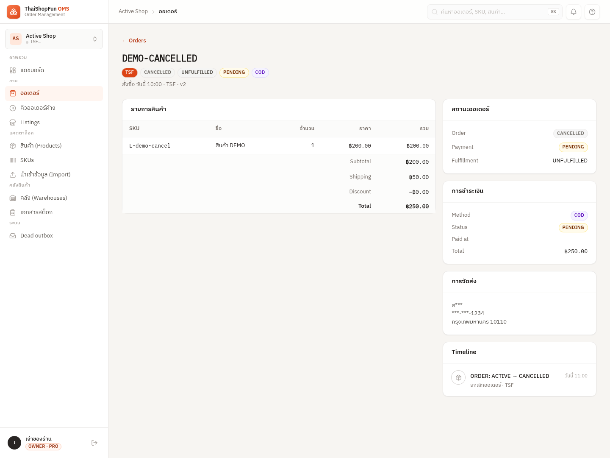
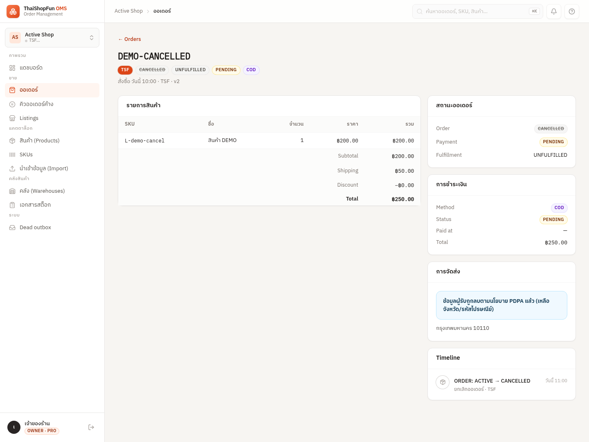

# T27 recipient card previews

These before/after screenshots render the real `OrderDetailPage`, `AppLayout`,
shared UI components, fonts and CSS in Chromium at 1440px, using an explicit demo
API fixture. They demonstrate the visual states; they are not evidence that the
Postgres job ran locally (Docker is unavailable in this environment).

For full-stack evidence, run `frontend/scripts/screenshot-pages.mjs` against a fresh
local/e2e demo stack. It invokes the audited local redaction control and captures
the same cancelled order before and after. `frontend/e2e/pii-lifecycle.e2e.ts` also
exercises this flow in CI and writes screenshots to test-results.

